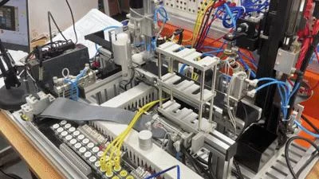

# PLC 기반 식품 자동 분류 및 창고 관리

Mitsubishi PLC와 HMI로 제품 검사·분류·적재를 제어하는 교육 프로젝트입니다. 복귀 위치와 병렬 동작을 조정해 **전체 공급 + 창고 비움의 총 동작 시간을 173.3초에서 152.8초로 단축했습니다(11.8%).**

**공동 개발:** 이종현 · 조병현  
**사용 기술:** Mitsubishi PLC · GX Works2 · Ladder Programming · HMI

[포트폴리오에서 보기](https://jonghyeon9084.github.io/#plc) · [발표자료 다운로드](docs/PLC_미니프로젝트_이종현_PPT.pptx)



## 공정 흐름

```text
제품 공급 → 컨베이어 이송 → 금속 검출
                            ├─ 불량품 → 배출 실린더 → 불량품 구역
                            └─ 정상품 → 좌·우 1~3층 포장 구역 (총 6개)
                                         └─ 포장 구역 만재 → 끝단 저장 창고
```

## 구현 기능

- **공급 모드:** 전체 공급 / 지정 위치 개별 공급
- **적재 관리:** 좌·우 1~3층 적재, 창고 비움, 적재 상태를 HMI 램프로 표시
- **비상 정지:** 실습 장비에서 흡착을 유지하며 동작 정지, 해제 시 중단 지점에서 재개
- **Teaching:** 조그 동작으로 중간 복귀 위치를 설정하고 ROM에 저장
- **시간 측정:** TTMR을 활용해 공급·비움 동작 시간을 계측
- **병렬 동작:** 분배 후 다음 소재를 바로 공급하고, 마지막 소재 처리 시 소재 없음 루프 방지

시퀀스 제어, HMI 연동, 동작 시간 측정·최적화는 공동 개발 범위입니다.

## 측정 결과

중간 복귀 위치를 60~140 mm 범위에서 20 mm 간격으로 변경했습니다. 이후 140 mm 조건에 병렬 동작을 적용했습니다.

| 복귀 위치 | 동작 조건 | 전체 공급 (초) | 창고 비움 (초) | 합계 (초) |
| ---: | --- | ---: | ---: | ---: |
| 60 mm | 기준 | 98.5 | 74.8 | 173.3 |
| 80 mm | 위치 조정 | 97.3 | 71.0 | 168.3 |
| 100 mm | 위치 조정 | 96.4 | 70.3 | 166.7 |
| 120 mm | 위치 조정 | 94.6 | 66.0 | 160.6 |
| 140 mm | 위치 조정 | 91.4 | 63.9 | 155.3 |
| 140 mm | 병렬 동작 추가 | 87.7 | 65.1 | 152.8 |

- **전체 개선:** `(173.3 − 152.8) / 173.3 × 100 = 약 11.8%` 시간 단축
- **병렬 동작의 추가 개선:** `(155.3 − 152.8) / 155.3 × 100 = 약 1.6%` 시간 단축

발표자료 13~14쪽의 측정값을 기준으로 계산했습니다. 원본 14쪽의 “추가 약 12%” 문구는 기준 대비 전체 개선과 혼동될 수 있어 위와 같이 구분했습니다. 이 결과는 해당 실습 장비·측정 조건에 대한 기록입니다.

## 트러블슈팅

**TTMR 레지스터 충돌:** 계측값을 D3000에, 합계를 D3001에 저장하도록 구성하면서 TTMR의 내부 사용 영역과 합계 저장 주소가 겹쳤습니다. 합계 저장 주소를 분리해 충돌을 해결했습니다.

## 파일 구성

```text
plc_project/
├─ plc/       GX Works2 프로젝트 (.gxw)
├─ hmi/       HMI 원본 폴더 전체
├─ docs/
│  ├─ PLC_미니프로젝트_이종현_PPT.pptx
│  └─ images/plc-system.webp
└─ README.md
```

## 자료 열기

1. 저장소 전체를 내려받거나 `git clone https://github.com/jonghyeon9084/plc_project.git`으로 복제합니다.
2. GX Works2에서 `plc/PLC_미니프로젝트_이종현_GXW.gxw`를 엽니다.
3. HMI는 원본 작성 환경에서 `hmi/PLC_미니프로젝트_이종현_HMI` 폴더를 함께 사용합니다. `Project.gt32` 하나만 분리하지 않습니다.
4. 전용 프로그램 없이 개요와 결과를 확인하려면 README, 포트폴리오 또는 발표자료를 참고하세요. 발표자료 4쪽은 시연 영상 슬라이드입니다.

원본 파일을 보존해 업로드했으며, 이번 저장소 정리 과정에서 PLC·HMI 편집기로 다시 열거나 실물 장비에서 재실행하지는 않았습니다.
